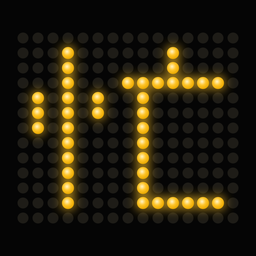
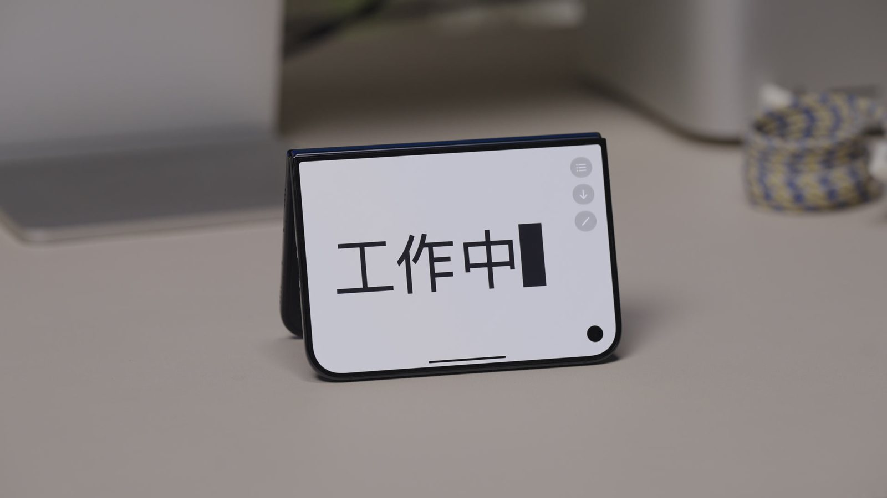
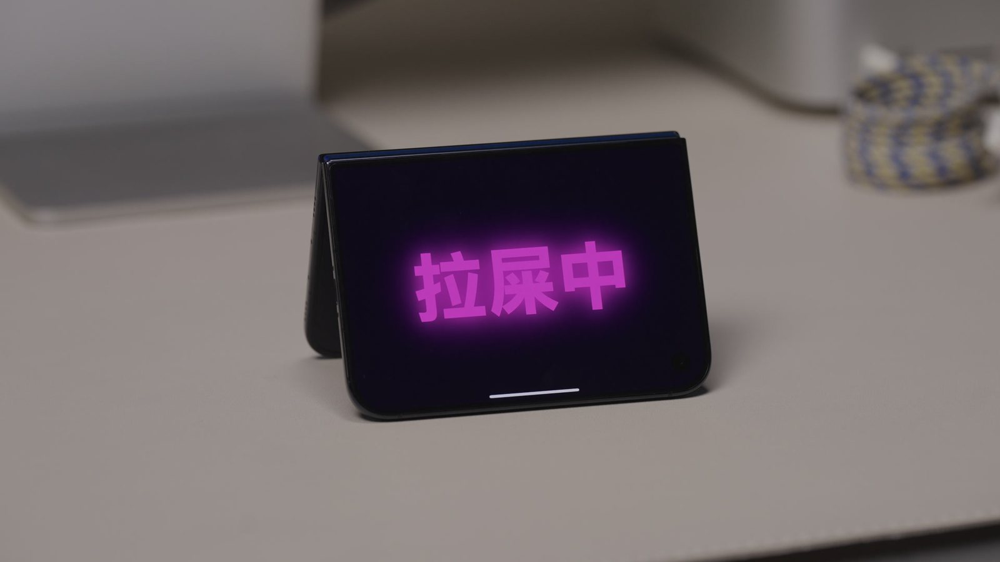
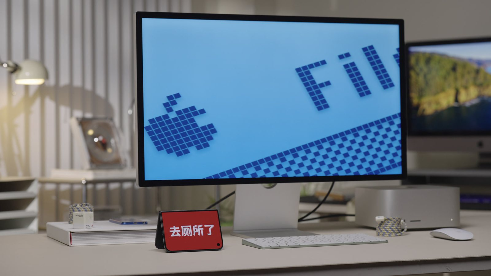

<p align="center">
  
</p>

<h1 align="center">光谱Spec · 工位指示牌</h1>

<p align="center">
  <b>Desk Sign</b> — 把 iPhone Duo 折成帐篷立在桌上，外屏就是你的工位状态牌。
</p>

<p align="center">
  
  
  
  
</p>

<p align="center">
  
  
</p>
<p align="center">
  
</p>

> 这是光谱Spec 为 iPhone Duo 做的三个「最没用、但非常适合 iPhone Duo」的 App 之一，另外两个是
> [广东模拟器](https://github.com/Xenogeneic112/GuangpuSpec-FoldSmash) 和 [摸鱼浏览器](https://github.com/Xenogeneic112/GuangpuSpec-DecoyScreen)。

## 怎么用

| 手机的状态 | 你看到的 |
| --- | --- |
| 拿在手里（合拢、书本、展平） | 状态列表。点一下选中；右滑或长按编辑；**+** 新建；可以拖动排序 |
| 折成帐篷立在桌上 | 选中的状态铺满朝外的那块屏幕，边到边，没有状态栏 |
| 手边没法立帐篷 | 点工具栏的 **显示指示牌**，长按指示牌退出 |

指示牌显示时：

- 关闭自动锁屏，牌子一直亮着。
- **双击**切换到下一个状态；**单击**显示或隐藏工具栏，在外屏上就能打开状态列表，不用展开手机。
- 10 分钟没有触碰会自动变暗，点一下唤醒。
- 文字每分钟轻微漂移几个像素，保护 OLED 不烧屏。

### 预设状态

工作中 · 营业中 · 去厕所了 · 请勿打扰 · 请帮我在电脑上点「允许」 · 假装在工作

每个预设都配好了自己的样式和动画，也可以随时新建、编辑、恢复预设（会按当前系统语言重建）。

### 5 种样式 × 9 种动画

- **样式**：霓虹、电子墨水、LED 点阵屏、商务、警报
- **动画**：静止、扫光、打字机、呼吸、闪烁、抖动、弹跳、明灭、滚动字幕

### 不碰手机也能换牌子

- **Siri / 快捷指令 / 聚焦搜索 / 操作按钮**：「设置我的工位指示牌」「工位指示牌下一条状态」。在 Mac 或 Apple Watch 上运行快捷指令，就能远程换掉桌上的牌子。
- **StandBy 小组件**：iPhone Duo 立成帐篷时会进入 StandBy，指示牌小组件用 5×7 点阵 LED 大字显示当前状态，并会跟随 App 里选中的状态。

## 帐篷模式是怎么判断的

Apple 规定帐篷模式下 App 的主界面显示在外屏上，所以：

- 铰链 `partiallyOpen` + App 在外屏（紧凑宽度）→ **帐篷**
- `partiallyOpen` + App 在内屏 → **书本**
- `closed` → **合拢**，`fullyOpen` → **展平**

见 `DuoKit/Sources/DuoKit/HingeModel.swift` 里的 `PoseClassifier`。

## 运行要求

- **Xcode 27.1**（iOS 27.1 SDK）。
- **iPhone Duo** 真机，或 Xcode Device Hub 里可折叠的 iPhone Duo 模拟器。

## 开始使用

```bash
git clone https://github.com/Xenogeneic112/GuangpuSpec-DeskSign.git
cd GuangpuSpec-DeskSign
open DeskSign.xcodeproj
```

1. 选择 scheme **DeskSign 中文**，运行目标选 iPhone Duo。
2. 真机运行前：在 **Signing & Capabilities** 里为 `DeskSign` 和 `DeskSignWidgets` 两个 target 选择你自己的 Team，并把 Bundle Identifier（默认 `com.example.duovibes.desksign`）和 App Group（`group.com.example.duovibes.desksign`，App 与小组件靠它共享状态）改成你自己的。
3. 按 ⌘R。在模拟器的 Device Hub 里把手机折成帐篷，就能看到指示牌。

## 项目结构

```
GuangpuSpec-DeskSign/
├── DeskSign.xcodeproj
├── DeskSign/              App：状态列表与编辑（RootView、StatusEditor）、指示牌渲染与动画（SignView）、
│                           状态存储（StatusStore）、Siri 与快捷指令（DeskSignIntents）
├── DeskSignWidgets/       StandBy / 主屏幕小组件
├── Shared/                App 与小组件共用：状态模型、LED 点阵字体、共享数据
├── Config/                entitlements（App Group）
└── DuoKit/                铰链层 Swift Package（三个 App 共用）
```

## DuoKit：铰链层

```swift
@State private var monitor = HingeMonitor()

var body: some View {
    Content()
        .readsHinge(into: monitor)
        .overlay(alignment: .bottomLeading) {
            HingeDebugPanel(monitor: monitor)   // 调试：实时读数 + 假铰链滑杆
        }
}

monitor.pose        // .closed / .tent / .book / .flat / .unknown
```

调试面板的 **Fake** 模式用滑杆驱动一切，预设（合拢 / 帐篷 / 书本 / 展平）会同时设置角度和 App 所在的屏幕，没有真机也能开发。唯一直接调用 Apple 新 API 的文件是 `DuoKit/Sources/DuoKit/LiveHingeReader.swift`。测试：`cd DuoKit && swift test`。

## 已知限制

- 内屏上的分屏窗格同样是紧凑宽度，可能被误判为帐篷模式。

## English

**Desk Sign** turns a folded iPhone Duo into a desk status sign. Stand it up as a tent and the outward-facing screen shows your status — "Working", "Do not disturb", "In the bathroom", "Please click Allow on my computer" — in one of five styles (neon, e-ink, LED board, corporate, alarm) with nine animations. Double-tap to cycle, auto-lock stays off, it dims after 10 idle minutes and drifts slightly to spare the OLED. Change it without touching the phone from Siri, Shortcuts (even on your Mac or Watch), or the StandBy widget. Requires Xcode 27.1 and an iPhone Duo or its simulator; set your own team, bundle ID and App Group before running on a device.

## 许可

[MIT](LICENSE) © 2026 光谱Spec
